# OpenDM40-Chinese

[opendm40](https://github.com/opendm40/opendm40) 开源万用表固件的**简体中文汉化**，
面向正点原子 **DM40A / DM40B / DM40C**。

两条版本线都在这个仓库里：

| 线 | 基于上游 | 固件 | 状态 |
|---|---|---|---|
| **v0.4.1（当前）** | v0.4.1 | `opendm40-v0.4.1-zh.bin` — 634,240 字节，CRC-32 `09785939` | 作者机器上日常在用；完整回归未做完（见[已知问题](#已知问题)）|
| v0.4.0（上一版） | v0.4.0 | `opendm40-v0.4.0-zh.bin` — 632,576 字节，CRC-32 `fd8d01b6` | 稳定版，可随时回退 |

两条线都已在 **DM40A 真机**上测试通过。

> opendm40 官方只有英文界面。本项目把主菜单、设置页、量程页等改为中文，
> 并提供一份完整的中文使用说明书。

---

## 目录

- [要刷的文件](#要刷的文件)
- [效果](#效果)
- [汉化范围](#汉化范围)
- [已知问题](#已知问题)
- [刷机（推荐：直接复制文件）](#刷机推荐直接复制文件)
- [刷机（备用：USB SCPI 脚本）](#刷机备用usb-scpi-脚本)
- [回退](#回退)
- [从源码重建](#从源码重建)
- [字形是怎么来的](#字形是怎么来的)
- [截图索引](#截图索引)
- [许可与来源](#许可与来源)
- [免责声明](#免责声明)

## 文档

| 文档 | 内容 |
|---|---|
| **[中文使用说明书](docs/opendm40-中文使用说明书.md)** | 全部按键、手势、每一页怎么用、安全告警、已知限制，约 8 万字节 |
| [更新记录](CHANGELOG.md) | 按日期列出所有改动 |
| [firmware/说明.md](firmware/说明.md) | 四份镜像分别是什么、该刷哪个 |
| [刷机与构建记录](docs/刷机与构建记录.md) | 怎么从源码重建 |
| [开发记录](docs/开发记录.md) | 设计取舍、走过的弯路、验证方法（给想改代码的人）|
| [patch/ 说明](patch/README.md) | 一百多个改动脚本分别做什么 |

## 要刷的文件

> **下载**：直接取仓库里的
> [firmware/opendm40-v0.4.1-zh.bin](firmware/opendm40-v0.4.1-zh.bin)。
> [Releases](https://github.com/xingyan4117-sketch/OpenDM40-Chinese/releases) 里的附件
> 目前还是上一版 `v0.4.0-zh10`（即 `opendm40-v0.4.0-zh.bin`）。

**`firmware/opendm40-v0.4.1-zh.bin`** —— 634,240 字节，
CRC-32 `09785939`，SHA-256 `455e0a4a…e8974ed7`

想回退上一版就刷 `firmware/opendm40-v0.4.0-zh.bin` —— 632,576 字节，
CRC-32 `fd8d01b6`，SHA-256 `b2ce5084…b763`。

校验：`sha256sum -c SHA256SUMS.txt`（Windows 用 `Get-FileHash` 逐个比对），
完整清单见仓库根的 `SHA256SUMS.txt`。

### 版本对照

**认准 CRC-32**：同一个文件名在不同版本里内容不同，光看名字分不出。

| 版本 | CRC-32 | 内容 |
|---|---|---|
| zh1 | `7ece9514` | 第一版：设置单页、图库多选、示波器全中文 |
| zh2 | `c2bd20c4` / `8e531b0e` | **附件发布后被覆盖过两次，别用** |
| zh3 | `8e531b0e` | 充电指示判定错误的版本 |
| zh4 | `140b5dc1` | 充电能变绿了，但整块都绿 |
| zh5 | `04d4ccb3` | 外观对了，但充电判定不可靠（拔线还在闪）|
| zh6 | `0434ffa9` | 绝对电压判定，只在快充满时有效 |
| zh7 | `fe7d08de` | 按内阻压降判定，但拔线偶尔还闪 |
| zh8 | `6803c2d3` | v0.3.0 汉化最终版 |
| zh9 | `12200498` | 移植到上游 v0.4.0（四通道示波器、协议解码器）|
| zh10 | `fd8d01b6` | v0.4.0 最终版：示波器五页全汉化、弹窗满宽、触发页两行布局 |
| **zh11** | `09785939` | **当前版本**：移植到上游 v0.4.1（六标签设置、9 档关机、暗屏方式、图库多选批量删除）|

> 从 zh3 起，**发布过的附件不再覆盖**；有新改动就发新 tag。


其余三个镜像**不要刷**（v0.3.0 存档、原版英文、原厂备份），
详见 [刷机](#刷机推荐直接复制文件) 一节。

## 效果

| 主菜单 | 示波器（四通道 + 全中文菜单） |
|---|---|
| 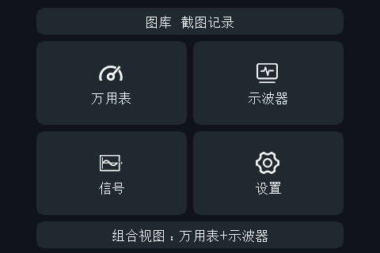 | 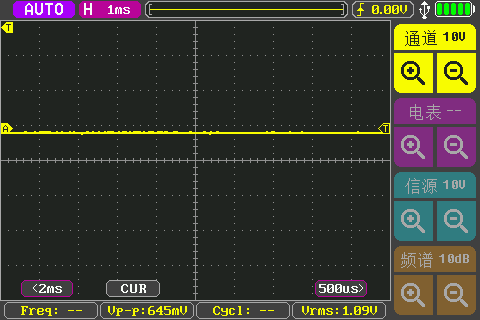 |

**示波器 MF 菜单：五个标签页全部中文**

| 测量 | 显示 |
|---|---|
| 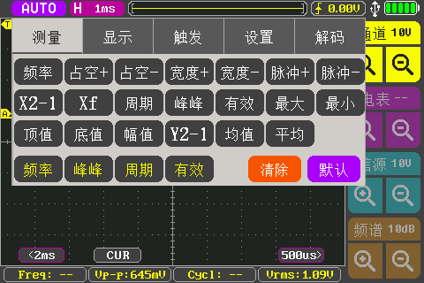 | 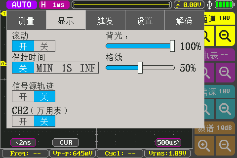 |

| 触发 | 解码 |
|---|---|
| 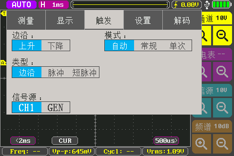 | 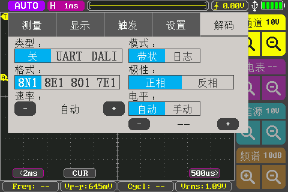 |

**设置（单页 24 项，每屏 6 行）**

| 设置页 | 采样率档位（慢/中/快） |
|---|---|
| 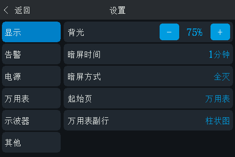 | 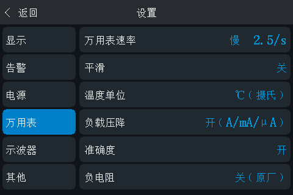 |

| 图库（多选批量删除） | 涌流 |
|---|---|
| 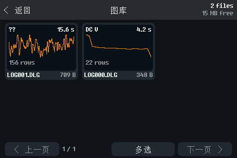 |  |

| 量程页 | 测量页 |
|---|---|
| 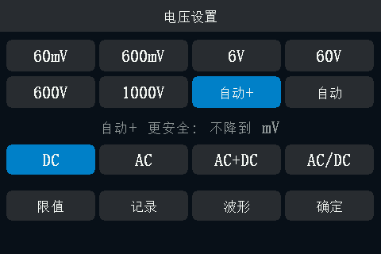 | 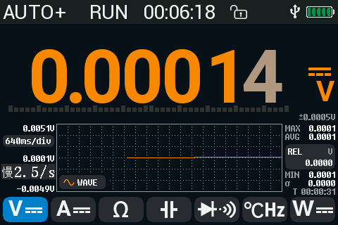 |

| 限值页 | 信号源 |
|---|---|
|  | 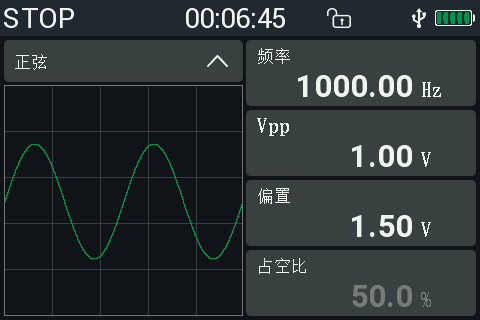 |

> 汉化范围：主菜单、设置、万用表各页、图库、限值页、设备信息、帮助页，
> 以及**示波器整套界面**（五个标签页、20 个测量项、四个通道色块、三个弹窗）。
>
> 仍保留英文的只有三类：**行业通用符号**（DC/AC、UART/8N1、FFT、dB/div）、
> **SCPI 关键字**（上位机通信需要），以及**12 px 小字区域**
> （图库文件数、功率设置脚注、示波器底部测量行——这些字体没有汉字字形）。

---

## 汉化范围

### 已中文

- **主菜单**全部 6 项：图库 截图记录 / 万用表 / 示波器 / 信号源 / 设置 /
  组合视图 万用表+示波器
- **设置页**：v0.4.0 是单页滚动 **24 项**；v0.4.1 是**六个标签**
  （显示 / 告警 / 电源 / 万用表 / 示波器 / 其他），两种布局的行标签与选项值都是中文
  （暗屏时间 5分 / 电源方式 自动 (按视图) / 显示行 柱状图 / U盘 只读 …）
- **量程页**：电压设置 / 电流设置 / 电阻设置 / **电容设置** / **二极管** /
  **频率/温度** / **功率设置**，自动+ 更安全：不降到 mV / 保持限值 / 波形 /
  确定 / 保险丝自检 / 涌流
- **温度设置页**：K热电偶 / PT100 / PT1000 / 10k 3950 / 10k 3435 / 100k 3950 /
  NTC自定义 / 单位: C / 偏移 / 点数值可输入 / 保持限值 / 确定 / **冷端 31.5 C**
- **万用表页传感器徽标**：K热电偶
- **功率计**：标题 功率设置 / 接线；状态行 **电流量程... / 电压校准...**；
  按钮 **电压校准 / 限值 / 确定**
- **限值页**：自动保持 / 限值 / 上限 / 下限 / 上限=读数 / 下限=读数 /
  清除限值 / 失败蜂鸣 / 记录，标题 `保持限值: DC V`，值 开 / 关
- **记录页**：间隔 / 时长 / 可用 / 每次 / 1分 / 手停 / 1小时 …
- **信号源**：频率 / 偏移 / 波形名 **正弦 / 方波 / 三角 / 上升**
- **示波器页签**：测量 / 显示 / 触发 / 设置，以及各页内容——
  测量页 清除 / 默认；显示页 滚动 开/关、余辉 关/最小/1s/无限、亮度、网格；
  触发页 边沿 上升/下降、模式 自动/常规/单次、类型 边沿/脉冲/窄脉冲；
  设置页 截屏 / 存CSV；通道弹窗 耦合 / 探头 / 颜色
- **涌流页**：准备中… / 就绪 N A / 已触发：记录 2 秒… / 就绪 / 取消 / 保存中…，
  以及三条冲突提示
- **各页标题与返回键**：设置 / 量程 / 键盘 / 设备 / 记录 / 图库 / 帮助 /
  涌流 / 触摸测试 / 温度设置 / 功率设置 / 功率计接线 / `↩ 返回` / 删除 / 无数据

### 仍为英文（有意保留）

| 位置 | 内容 | 原因 |
|---|---|---|
| 示波器底部测量行 | Freq / Up-p / Cyc1 / Urms | 12 px 小字（`SC_F12`），汉字放不下；该行只是四个读数的简写 |
| 状态栏 | AUTO+ RUN HOLD STOP | `F21` 字体只有数字与部分字母，且属通用符号 |
| 图库文件数 / 页码 | 9 files / Page 1 of 2 | 12 px 小字 |
| 功率设置页脚注 | V gain … factory | 12 px 小字 |
| 信号源的 logic level | Vpp / 偏移 框右上角小注 | `F14`（14 px、行距 12 px），汉字放不下 |
| 通用符号 | DC/AC/AC+DC、UART/8N1/DALI、FFT/ABS、dB/div、Vpp、CH1 | 行业符号与协议名，保留原文更易对照 |
| 单位与标准缩写 | 60mV 6V AUTO+ DC/AC/AC+DC Vpp PT100 | 本身就是符号与传感器型号 |
| 少量值 | Irms 100 ms Peak Duty No data Fast Reset Wh 之外 | 为放下其余译文而回退 |

**帮助页保留**（设置里的「帮助」一行进入，含手势与按键说明；早期版本曾移除，现已恢复了）。
它原本是 7 页英文速查，汉化过程中逐步减到 1 页 4 行，最后整页删除——
内容在 docs/opendm40-中文使用说明书.md 里更完整。

---

## 已知问题

完整的限制说明见 [说明书 第二十一章](docs/opendm40-中文使用说明书.md)。这里只列要点：

| 项 | 现状 |
|---|---|
| **14 px 字体的英文** | 功率计接线图 `SOURCE`/`LOAD`、涌流右栏 `IDLE`/`FILE`、BMP 详情行、触摸校准公式——14 px 字体**没有任何汉字字形**，要改必须先改布局 |
| **状态栏缩写** | `AC?` `HOLD` `REL` `REC` `HV` 混在一个 83 px 槽里，单改报警会不协调，保留 |
| **示波器 20 个测量缩写** | `Vp-p` `Vrms` `Freq` … 格子只有 55 px，中文放不下 |
| **刷机后偶发不重新枚举 USB** | 拔插一次即可恢复；**不是固件复位**——表仍在运行，`DBG:BOOT?` 的加载器标记有效、崩溃计数为 0 |
| **闪存余量见底** | B 区（零等待）已贴着下限、A2 区只剩零头，只有 C 区（慢速 flash）还剩几 KB。再加中文前要先腾空间——把冷字库/冷代码挪到 A2 或 C 区。具体余量看自己构建时 `build.sh` 打印的 `region … free` |
| **未完整回归** | 校准源精度、蓝牙配对、USB 文件写入、全部触发/量程组合——都要外设或标准源才能测。v0.4.1 上：功率计接线弹窗、图库多选批量删除、记录页、限值页已实测 |

> 两个版本的行为差别：**v0.4.1** 设置页是六个标签、关机 **9 档**
> （10分 / 30分 / 1小时 / 2小时 / 4小时 / 8小时 / 12小时 / 24小时 / 从不），
> 并多一档**暗屏方式**——`变暗` = 5% 背光常亮，`全灭` = 先 5% 暗 10 秒再背光归零，
> 触摸或按键先唤醒（第一次输入只唤醒，不执行）；
> **v0.4.0** 是单页滚动 24 项、关机 15 档、没有「暗屏方式」。

> 曾经记过的两条「缺陷」已经撤销：查看器正文不渲染、图库对话框收不到点击。
> 2026-11-01 复测都正常，是当时拍照/操作的时机问题。

## 刷机（推荐：直接复制文件）

**这是最省事的方式，2026-11-01 实机验证通过。**

### 刷哪一个文件？

> ## 就刷：`firmware/opendm40-v0.4.1-zh.bin`
> **634,240 字节**，CRC-32 `09785939`，SHA-256 开头 `455e0a4a`

仓库里一共 5 个固件镜像（外加一个构建用的链接脚本），**只刷第一个**：

| 文件 | 是什么 | 刷吗 |
|---|---|---|
| **`firmware/opendm40-v0.4.1-zh.bin`** | **当前汉化版（基于上游 v0.4.1）** | ✅ **刷这个** |
| `firmware/opendm40-v0.4.0-zh.bin` | 上一版汉化（基于 v0.4.0，单页 24 项设置） | 想回退上一版时用 |
| `firmware/opendm40-v0.3.0-zh.bin` | 旧的 v0.3.0 汉化版（仅存档） | ❌ 只有想回退旧版才用 |
| `firmware/opendm40-v0.3.0-official.bin` | 上游 opendm40 v0.3.0 原版，**英文界面** | ❌ 只有想回退英文版才用 |
| `firmware/dm40_v_2_6-stock.bin` | **原厂 V2.6** 固件备份 | ❌ 只有想刷回出厂才用 |
| `firmware/link-native.x` | 链接脚本，不是固件 | ❌ 不能刷 |

### 前提：U 盘挂得出来吗？

这个 2 GB 的 U 盘**不是真 SD 卡**，是 opendm40 自己模拟的（体积 4160541 扇区 ≈ 1.98 GiB，
FAT16，卷标 DM40）。所以有几个前提：

| # | 前提 | 说明 |
|---|---|---|
| 1 | **表在正常运行**（不是加载器/恢复模式） | 虚拟盘由 opendm40 提供，加载器里没有 |
| 2 | **用能传数据的 USB 线** | 设备管理器里要能看到 DM40 multimeter (opendm40) **和** USB 大容量存储设备 |
| 3 | **设置第 19 行「U盘」= 可写** | 只有「可写 / 只读」两个值。只读**能挂载但拷不进去**，刷不了 |
| 4 | **改完只读/可写要重插 USB** | 那一行会显示「可写 (重插)」「只读 (重插)」——括号就是提醒你拔插 |
| 5 | **不要在记录/图库读写时刷** | 磁盘忙时主机侧拿不到盘（固件里是 E_BUSY，界面提示「磁盘忙」）；必要时发 DBG:VDISK:EJECT 让主机先释放 |
| 6 | **Windows 不会自动发现新盘** | 实测：设备已就位、VID_1209 三个接口都在，但资源管理器没有盘符 → Update-HostStorageCache 之后 E: DM40 才出现 |

插上后按这个顺序自查：

```powershell
# 1. 设备在不在（正常应为 3 个接口）
(Get-PnpDevice -PresentOnly | Where-Object { $_.InstanceId -match 'VID_1209' }).Count

# 2. 盘在不在（卷标 DM40，约 2 GB）
Get-Volume | Where-Object FileSystemLabel -eq 'DM40' | Select-Object DriveLetter, SizeRemaining

# 3. 看不到盘就刷新一次
Update-HostStorageCache
```

> **U 盘和 SCPI 是两条独立通道**（接口 0 = 仪器，接口 1 = 存储），可以同时存在；
> 但刷机过程中不要两边同时操作——主机锁盘时表上的画面不会刷新。
> 嫌麻烦就用下面的 **SCPI 直传**，它不经过 U 盘挂载，完全没有 5、6 两个问题。

### 步骤

1. **USB 线连电脑**，表会挂成一个 U 盘（卷标 `DM40`，约 2 GB）
2. **把 `firmware/opendm40-v0.4.1-zh.bin` 复制到 U 盘根目录**，
   文件名随便，但**必须是 `DM40*.BIN`**
   （例如存成 `DM40FW.BIN`；叫 `firmware.bin` 就不会被识别）
3. **安全弹出 / 卸载该卷**（让电脑把缓存写完）
   ```powershell
   # 假设表是 E: 盘
   Copy-Item firmware\opendm40-v0.4.1-zh.bin E:\DM40FW.BIN
   Write-VolumeCache -DriveLetter E
   mountvol E: /P
   ```
4. 表上弹出确认框：

   ```
   ┌──────────────────────┐
   │      固件已接收       │
   │      现在安装         │
   │   [ 否 ]    [ 是 ]   │  ← 红色「是」
   └──────────────────────┘
   ```

5. **点「是」** → 安装 → 自动重启（约 20~25 秒后重新枚举 USB）

不点或 60 秒超时 = 自动「否」，镜像文件被删掉，**原固件不受影响**。

**容错**：文件损坏 / 长度不对 / 中断都会在校验阶段被拒，弹「不是 DM40 升级文件」，
不会变砖。提交前断电只会在空闲簇里留下未链接的数据。

> 这条路径的代码在 `src/vwrite.rs`（U 盘根目录出现 `DM40*.BIN` → 校验 → 链接成
> `DM40FW.BIN` → 弹「固件已接收」）。早期 README 写过"这条路不工作"，那是错的，
> 2026-11-01 实测走通并把截图存进了 `screenshots/`。

## 刷机（备用：USB SCPI 脚本）

需要 Python 环境和 WinUSB 驱动，好处是有 **CRC-32 端到端校验**、不用在表上点确认。

### 1. 准备 USB 驱动

Windows 自带没有 USBTMC 驱动，设备管理器里该设备显示为「其他设备 · 代码 28」。

1. 下载 [Zadig](https://zadig.akeo.ie/)
2. **以管理员身份运行** → `Options` → `List All Devices`
3. 下拉列表里找到 **`DM40 multimeter (opendm40)`**，会显示两个条目：
   - **`(Interface 0)`** ← **选这个**（仪器接口）
   - `(Interface 1)` ← 不要选，那是大容量存储
4. 目标驱动选 **`WinUSB`** → `Install Driver`

### 2. 准备 Python 环境

```bash
pip install pyvisa pyvisa-py pyusb libusb-package
```

### 3. 刷入

```bash
python tools/upload_zh.py firmware/opendm40-v0.4.1-zh.bin --update --wait 120
```

它会：

1. `DBG:UPLOAD:BEGIN <len>,<crc32>`
2. 分块 `DBG:UPLOAD:DATA <offset>,<232 字节>` 传 634 KB，约 9 秒
3. `DBG:UPLOAD:END?` —— **表自己重新读取文件并校验 CRC-32**
4. `DBG:UPDATE` —— 清零加载器标记并复位，原厂加载器安装固件
### 4. 验证

```bash
python tools/dm.py --query 'DBG:BOOT?'
```

返回的加载器标记应与镜像头部一致（三个字由加载器在安装时写入；`NONE` 表示拿不到启动信息）。
长度字可以直接核对：**它等于镜像字节数 − 12**——本机实测 634,240 字节的镜像对应
`0x0009AD74`，所以 zh10 的 632,576 字节应为 `0x0009A6F4`。

也可以插上 USB，检查 `INFO/FIRMWARE.BIN` 的 SHA-256 是否等于所刷镜像。

### 5. 截屏（可选）

```bash
python tools/shot.py out.png
```

---

## 回退

用同样的工具，换镜像即可：

```bash
# 回上一版汉化（v0.4.0）
python tools/upload_zh.py firmware/opendm40-v0.4.0-zh.bin --update --wait 120

# 回官方英文版
python tools/upload_zh.py firmware/opendm40-v0.3.0-official.bin --update --wait 120

# 回正点原子原厂固件（有中文界面）
python tools/upload_zh.py firmware/dm40_v_2_6-stock.bin --update --wait 120
```

**刷固件从不改动标定区**（`0x080C0000`），所以回退后测量精度不变。

> 无论如何，**装好 opendm40 后第一件事是把 U 盘里的 `INFO/` 整个拷走**。
> 里面的 `CALIB.BIN`、`BOOTDATA.BIN`、`UID.BIN` 是这台表独有、**无法重建**的。

---

---

## 从源码重建

需要 Rust 工具链（`thumbv7em-none-eabihf` + `llvm-tools`）与 git-bash。
Windows 上的几个坑（`RUSTUP_HOME` 要用 Windows 路径、`PATH` 要用 MSYS 路径、
`stackdepth.py` 缺 `.exe` 后缀）见 `docs/刷机与构建记录.md`。

**两条线做法不同，别混用：**

| 版本 | 做法 | 脚本 |
|---|---|---|
| v0.3.0（zh1 – zh8）| 文本锚点替换：一个改动一个补丁，按编号顺序跑 | 全部在 `patch/`：`mkpatch2.py` ~ `mkpatch35_cross.py` |
| v0.4.0（zh9、zh10）| 上游改了约 5,000 行，锚点全废；改用「147 条文案对照 + 逐条翻译」 | **未随仓库发布**，见 [patch/README.md](patch/README.md) 末节 |

所以本仓库**不能一键重建 zh10**（补丁脚本留在上游开发环境里）。能照下面重建的是
v0.3.0 线；zh10 每一处改动见 [CHANGELOG.md](CHANGELOG.md)。

```bash
git clone --depth 1 --branch v0.3.0 https://github.com/opendm40/opendm40.git
cd opendm40
python3 ../patch/mkpatch2.py firmware/src ...     # 按编号 2 → 35 顺序，不能跳
python3 ../patch/derive_sets.py <vendor-cjk-set> firmware/src/*.rs
python3 ../patch/rebuild_fonts.py --pristine ... --out firmware/src/stockfont_data.rs ...
firmware/build.sh
```

### 闪存余量（很紧）

**以自己构建时 `build.sh` 打印的 `region A2 free / region B free / region C free` 为准**，
那才是你这份代码的真实余量。当前版本的量级：B 区（零等待）已经贴着链接脚本下限，
A2 区（同样零等待）只剩零头，三个区域里只有 C 区（慢速 flash，放冷代码）还有几 KB。

链接脚本里的硬性下限写在 [`firmware/link-native.x`](firmware/link-native.x)：
**B 区 3,900 字节、C 区 3,400 字节**，低于此值直接链接失败。

实测：**一个 22 px 汉字在 B 区约占 64 字节**（50 字节位图 + 10 字节条目 + 对齐）——
再加几个汉字就能把这些余量吃掉。想继续加中文必须先腾空间：把一块冷字库或冷代码
挪到 A2 / C 区（`K_FONT_B` 约 2.3 KB，挪得动）。
`patch/` 里的脚本和 `docs/` 记录了每一步是怎么换来的。

---

## 字形是怎么来的

| 来源 | 数量 | 说明 |
|---|---|---|
| 原厂 V2.6 固件自带 | 104 个 | opendm40 已内嵌原厂位图字体，按字符串实际用字裁剪 |
| 宋体渲染补齐 | 297 个 | 原厂字集没有的字，用宋体 22 px 二值化后按原厂格式编码；**TEXT22 现在共 401 个字形** |

### 三个必须对齐的地方

1. **编码约定**：TEXT22 的 h 是格子高度（恒 22），	 是墨迹首行，
   ih 是墨迹高度，yoff 恒 0。F14 相反：h 就是墨迹高度、	 恒 0、
   纵向位置放在 yoff。用错一套，字就会被裁掉一截。
2. **基线**：原厂 94 个汉字里有 84 个的墨迹底端落在第 20 行。手绘字最初
   一律「顶端对齐到第 1 行」，结果笔画短的字（如 上）悬空 2 像素。
   现在满高字的墨迹底端统一压到第 20 行——**142/144 手绘字与原厂落在同一基线上**。
3. **渲染画布**：宋体 22 px 的墨迹是 20 行，基线压在画布底边会把最后 2 行裁掉。
   正确做法是在放大画布上渲染、取墨迹包围盒后再贴进格子。


## 截图索引

`screenshots/` 下 30 张实机截图，都是这台机器上拍的（480×320 原始分辨率）。

**主界面**
主菜单 · 测量页 · 量程页 · 限值页 · 信号源

**示波器（v0.4.0 全汉化）**
示波器 · 示波器-测量页 · 示波器-显示页 · 示波器-触发页 · 示波器-解码页 · 示波器-设置页

**设置**
设置页 · 设置页-采样率

**图库**
图库

**功率与安全**
功率计设置页-中文 · 涌流页-中文 · 报警提示-保险丝 · 保险丝自检对话框 · 接线对话框-中文

**其他页面**
温度设置 · 电容设置 · 电流设置 · 触摸测试-中文 · 记录已保存 · 记录暂不可用 · 采样率提示

**充电指示**
电池-不充电时白色 · 电池-充电中闪下一格

**开机画面与刷机**
开机画面-xingyan标 · 刷机-复制到U盘后弹窗

> 早期 v0.3.0 的中间过程截图（含被淘汰的旧版充电指示、英文界面）已清理，
> 只保留与当前固件一致的部分。历史对照见 [版本对比文档](docs/版本对比-v3与v4.md)。

---

## 许可与来源

- **代码**：沿用上游 opendm40 的 **MIT**，见 [LICENSE](LICENSE)
- **上游项目**：[opendm40/opendm40](https://github.com/opendm40/opendm40)，MIT
- **中文字形**：104 个来自正点原子 DM40 V2.6 原厂固件的位图字体；
  297 个由宋体（SimSun）渲染补齐（共 401 个，见上文「字形是怎么来的」）
- `firmware/dm40_v_2_6-stock.bin` 是**正点原子官方固件，版权归其所有**，
  仅为方便回退而附带
- 本项目与正点原子（Alientek）无关，未获其授权或认可

> ⚠️ 如果你的用途对字体授权敏感（例如商业分发），建议把 69 个手绘字形
> 改用 OFL 授权的开源字体（如 Noto Sans SC / 思源黑体）重新渲染后重编。

---

## 免责声明

刷第三方固件**可能失去原厂保修**，也存在变砖风险。opendm40 的设计
（不动 bootloader、不动标定区、升级失败停在加载器）把风险压到很低，
但**请自行承担后果**，并务必先备份 `INFO/`。

opendm40 上游标注其状态为 **Experimental**：只在一台 DM40A 上实测，
DM40B / DM40C 仅在模拟器验证。涉及 A 插孔通电流的功能未上真机。
